# Lecture 02: Prisoner’s Dilemma-Introduction and Analysis

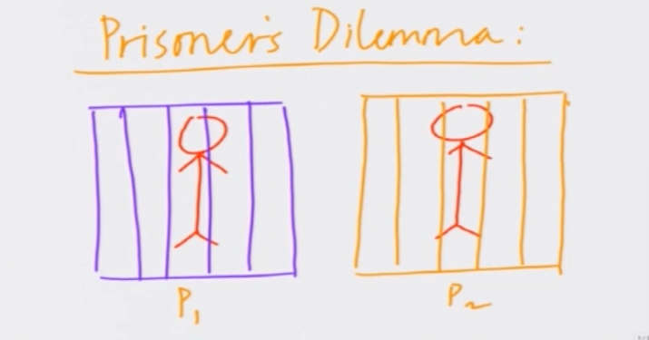

* Assused of a major crime
  * No eyewitness
  * To get one or both to CONFESS

* Investigators device a plan
* Both of them interrogated separately
* Both prisoners are interrogated in separate rooms. No communication allowed between them.

2 Possible Actions for both prisoners  
* Confess(C)
* Deny(D)

## Utilities

* If both deny, each gets 1 year sentence.
* If both confess, each gets a prison sentence of 3 years
* If one confesses and other denies, confessor walks free or 0 year prison sentence
* One who denies gets a sentence of 4 years

## Let's fit into model of a game

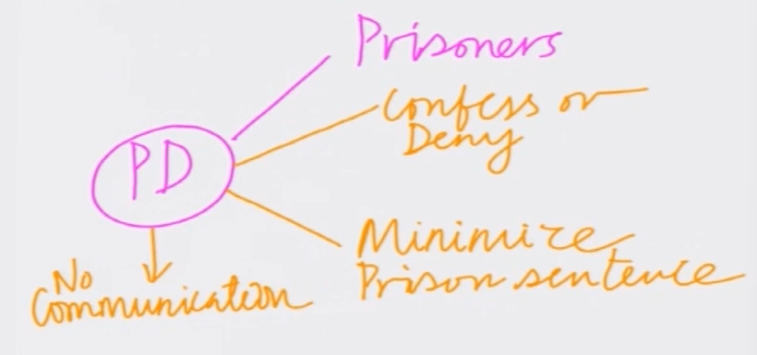

> To analyze we will use a Game Table

## Game Table :

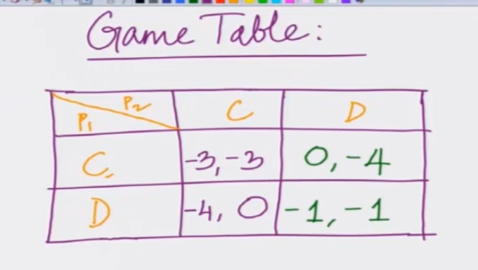

* Payoff is determined by action of individual together with actions of competitors

> Now let's do the mathematical notation  

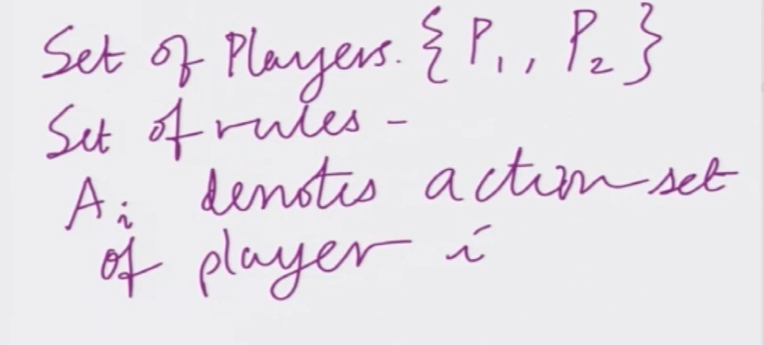

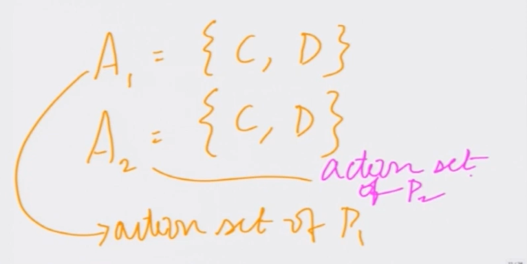

> What are different outcomes  

It's a cartesian product of both sets

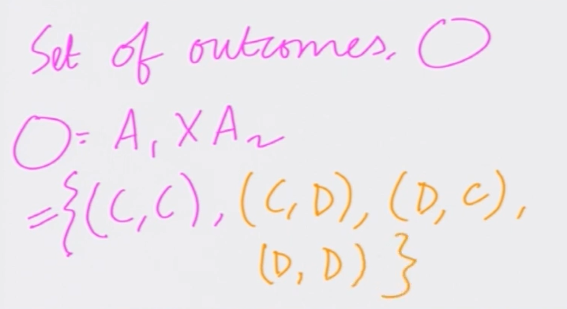

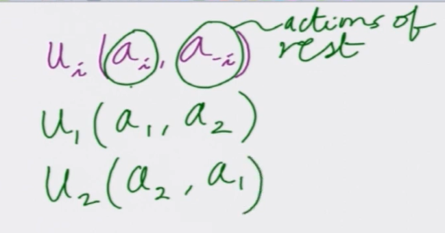

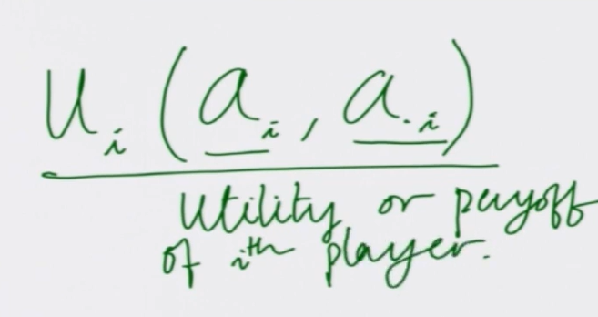

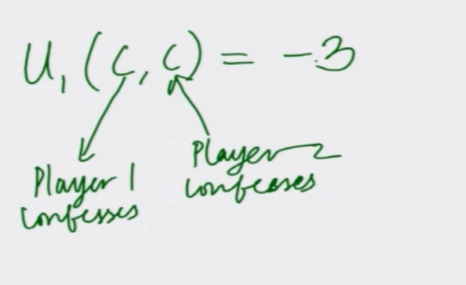

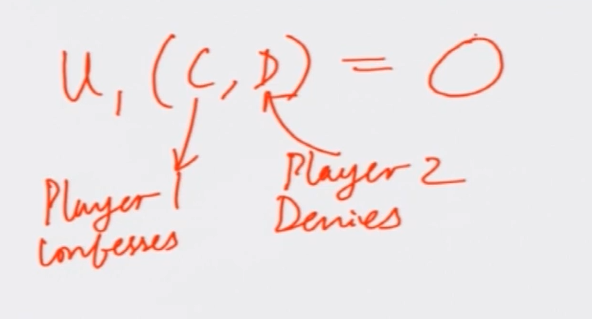

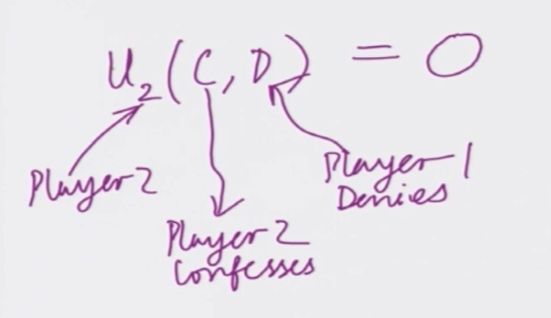

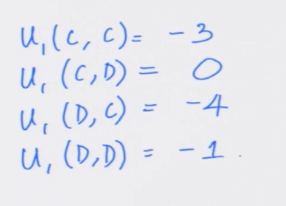

> C means confess and D means deny
> For player 2

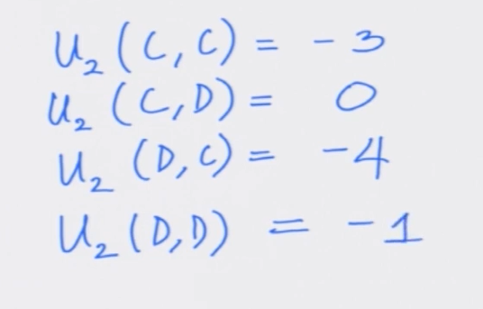  

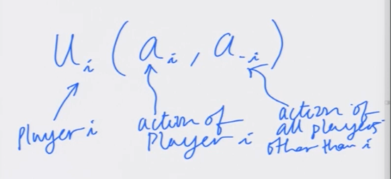

## Why is PD useful in practise

e.g.  
* Retail Price war
  * 2 Shops, Retail chains
  * Prices - High or low

so I can model it as below

Profit of 500 if both of them set high  
if both of them set low price, both of them gets loss of 250

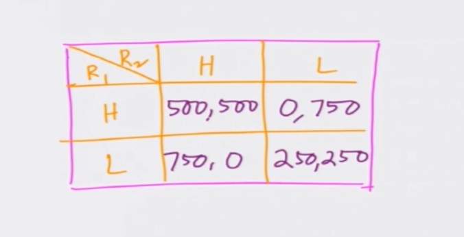

> Above is prisoners kind of dilemma
> Simple market competition  

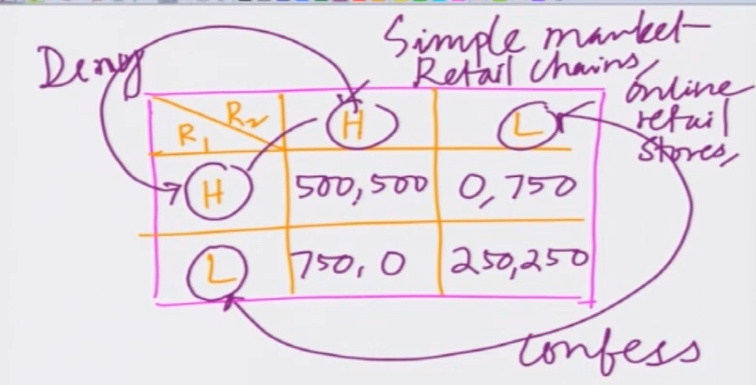